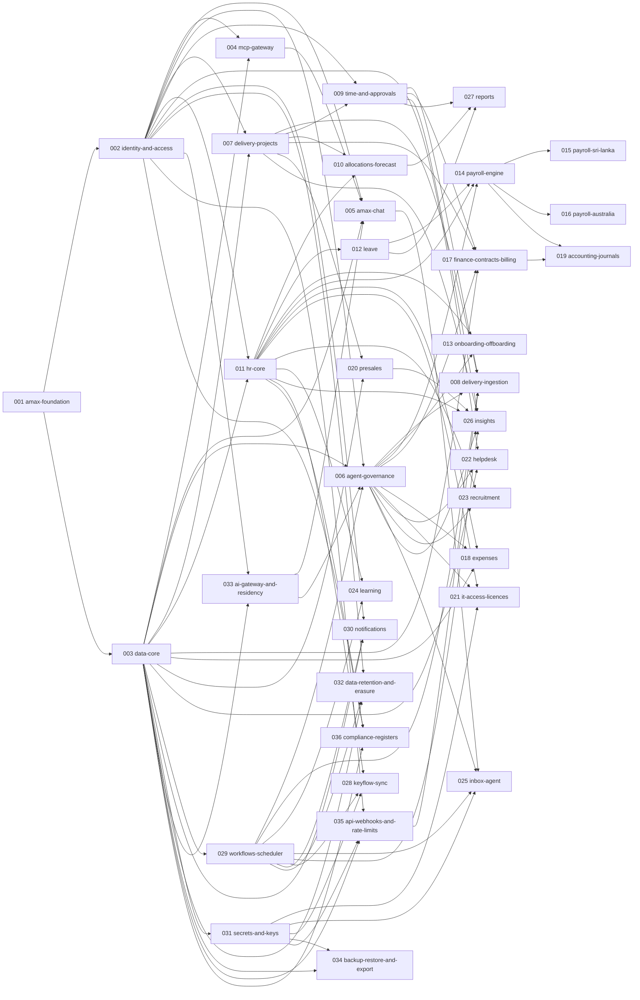

# amax roadmap: from agent-native PSA to services ERP

amax is an independent, multi-tenant product for **software and professional-services companies**: delivery, people, time, payroll and money in one system. Every capability is exposed over MCP, so agents do the record-keeping and people make the decisions.

The category it competes in is **PSA + HCM + services finance**, against Kantata, Certinia, Scoro, Odoo and Zoho People/Payroll, plus point tools such as Jira, BambooHR and Xero. What sets amax apart: agents create the records (commits log time, deployments move releases, approved hours become invoices), and one permission model covers both the UI and MCP.

## Platform (cross-cutting, built first)

| Capability | Why it matters for an ERP |
|---|---|
| Multi-tenant, multi-entity, multi-currency | A customer runs several legal entities (e.g. Sri Lanka + Australia) in one tenant |
| Identity: any OIDC (Entra ID, Google Workspace, Okta), SCIM user sync | Independent product; Entra is just the first connector |
| Roles + data scopes (entity, department, project) + field-level masking (salary) | HR and payroll data need finer permissions than delivery data |
| Approval/workflow engine | Leave, timesheets, expenses, offers, pay runs and releases all use one engine |
| Audit log on every write, with the acting agent and the person it acts for | Needed for ISO 27001, SOC 2 and payroll audits |
| MCP server covering every endpoint, plus webhooks and a REST API | Core to the product's positioning |
| "Fill with amax": chat and voice capture for every create flow, producing a reviewable draft | Records come from conversation, not forms |
| Inbox agent: background ingestion from Teams and Outlook (scoped channels and mailboxes, admin consent), suggestions a person accepts | Data arrives without anyone typing it |
| Country packs | Holidays, leave rules, tax, statutory funds and filing formats, plugged in per country |
| Notifications: email, Teams, Slack; Teams/Slack app; mobile web | People act where they already are |
| Documents and e-signature (provider integration) | Contracts, offers, letters, policies |
| Tenant isolation: row-level security, tenant from the sign-in token (002, 003) | One customer's data can never reach another's |
| Secrets and keys per tenant, envelope-encrypted (031) | Connector credentials never sit in env vars or logs |
| Retention, erasure and access requests (032) | Sri Lanka PDPA and the Australian Privacy Act |
| AI gateway: one path for every model call, redaction, prompt-injection guard, data region (033) | Pay and health data never leave unless allowed |
| Backup, restore drills, tenant export and deletion (034) | Payroll and HR records can't be lost |
| REST API, signed webhooks, rate limits (035) | Machine callers are verified and can't starve a tenant |

## Modules

### 1. Delivery (PSA core): changes 001–009
Projects, sprints and board, specclaw proposals, releases and environment promotion, risk/issue (RAID), change and decision logs, milestones, git and CI ingestion, git-identity mapping.

### 2. Resource management
Allocations, future allocations, bench, skills matrix, availability, capacity vs demand forecast, "who can staff this?" search (an agent can ask it over MCP).

### 3. Time and attendance
Agent-logged timesheets and approvals. **Leave**: policies, accruals, balances, carry-over, approvals and public-holiday calendars per country. Attendance and biometric import, work-from-home logs, overtime.

### 4. HRM (core HR)
Employee record, org chart, positions, employment contracts and history, documents, probation, confirmations, transfers, promotions. Employee self-service: profile, letters (employment and salary confirmations), payslips, leave. Onboarding/offboarding checklists across HR, IT and Admin, plus exit interviews.

### 5. Payroll
Pay components, pay groups, pay runs with variance checks, payslips, bank payment files, payroll journals to the GL, final settlements.
- **Sri Lanka pack:** APIT/PAYE, EPF (8% employee, 12% employer), ETF (3%), monthly C-form and returns, gratuity.
- **Australia pack:** PAYG withholding, Superannuation Guarantee, Payday Super (super paid with wages from 1 July 2026), Single Touch Payroll Phase 2.
- Then other countries through the country-pack SDK.

Agent angle: a payroll agent explains every change from last month ("+LKR 12,400 because of 6 h overtime") before a person approves the run.

### 6. Talent
- **Recruitment (ATS):** job requisitions raised from resource demand and bench forecasts, pipeline, interviews, scorecards, offers with e-signature, hire → employee record.
- **Performance:** provided by the sister product Keyflow (see below).
- **Learning and development:** programmes, who took part, completion, hours, certifications with expiry, and skills growth linked to the skills matrix.

### 7. Finance (services finance)
- **Contracts:** fixed price, time and materials, retainers.
- **Billing:** time-and-materials invoices built from approved time; milestone invoices triggered when a release reaches Prod. Accounts receivable and collections with reminders.
- **Costs and planning:** expenses and reimbursements (receipt capture), vendor bills, procurement and approvals, budgets.
- **Project profitability:** revenue against the real cost of time, using rates from payroll.
- **Ledger:** integrate the GL first (Xero, QuickBooks, Business Central) through posted journals, rather than building a general ledger.

### 8. CRM and presales
Leads, accounts, opportunities, weighted pipeline, presales activities and RAID items, proposal tracking, win → project conversion, partner/referral programs.

### 9. IT and assets
Asset register and assignment linked to onboarding/offboarding, plus device-management sync (Intune and similar tools).

### 10. Governance and compliance
Policy library with read-and-acknowledge tracking, ISMS registers (risks, incidents, assets, suppliers), and audit evidence export (ISO 27001, SOC 2).

### 11. Access and licences
One place per person for everything they can use: Entra groups and roles, Microsoft 365 and other SaaS seats, Azure DevOps and GitHub access, cloud roles, and Intune devices. Includes licence spend, unused-seat detection, access reviews, and revocation on the person's last day.

### 12. Helpdesk
IT, HR and facilities queues with SLAs, tickets from Teams and email, and a support agent that drafts answers and prepares access requests and HR letters for a person to approve. Password and MFA resets always go to IT with identity verification.

### 13. Insights (agent intelligence)
Recurring agent jobs that write a weekly briefing:
- Projects at risk, with reasons and confidence.
- Opportunities matched against the company's skills.
- Talent growth: headcount, skills, attrition and promotions.
- Market position: win rate, share of voice, reviews against peers.
- World trends to take on, watch or skip.

Every insight links to its evidence, and people can switch each job on or off.

### Sister product: Keyflow
OKRs, check-ins, feedback and recognition live in Keyflow, which syncs both ways with amax (people and teams out; goals, review scores and recognition in).

### 14. Analytics
Utilisation, margins, revenue forecast, headcount and attrition, payroll cost, cash flow, plus executive dashboards, scheduled reports and a BI export (Power BI, Fabric).

## Build order: dependency waves

Proposals in the same wave have no dependency on each other, so separate teams or agent runs (each in its own git worktree) can build them at the same time. A proposal can start as soon as everything it depends on is merged; waves are just the earliest possible slot.

| Wave | Proposals (lane) |
|---|---|
| 0 | 001 amax-foundation (Platform) |
| 1 | 002 identity-and-access (Platform), 003 data-core (Platform) |
| 2 | 004 mcp-gateway (Platform), 007 delivery-projects (Delivery), 011 hr-core (People), 029 workflows-scheduler (Platform), 031 secrets-and-keys (Platform), 033 ai-gateway-and-residency (Platform) |
| 3 | 005 amax-chat (Platform), 006 agent-governance (Platform), 009 time-and-approvals (Delivery), 010 allocations-forecast (Delivery), 012 leave (People), 020 presales (Sales), 024 learning (Talent), 028 keyflow-sync (Integrations), 030 notifications (Platform), 032 data-retention-and-erasure (Platform), 034 backup-restore-and-export (Platform), 035 api-webhooks-and-rate-limits (Platform), 036 compliance-registers (IT) |
| 4 | 008 delivery-ingestion (Delivery), 013 onboarding-offboarding (People), 014 payroll-engine (Payroll), 017 finance-contracts-billing (Finance), 018 expenses (Finance), 021 it-access-licences (IT), 022 helpdesk (IT), 023 recruitment (Talent), 025 inbox-agent (Intelligence), 026 insights (Intelligence), 027 reports (Delivery) |
| 5 | 015 payroll-sri-lanka (Payroll), 016 payroll-australia (Payroll), 019 accounting-journals (Finance) |

## Lanes and owners

Each lane can be given to one team; the platform team owns the platform lane and reviews module contracts.

| Lane | Proposals | Module folders (CODEOWNERS) |
|---|---|---|
| Platform | 001, 002, 003, 004, 005, 006, 029, 030, 031, 032, 033, 034, 035 | `apps/web`, `deploy/`, `modules/notifications`, `packages/agents`, `packages/ai`, `packages/api`, `packages/auth`, `packages/chat`, `packages/core`, `packages/db`, `packages/mcp`, `packages/privacy`, `packages/workflows` |
| Delivery | 007, 008, 009, 010, 027 | `modules/allocations`, `modules/delivery`, `modules/reports`, `modules/time` |
| People | 011, 012, 013 | `modules/hr`, `modules/leave`, `modules/onboarding` |
| Payroll | 014, 015, 016 | `modules/payroll-au`, `modules/payroll-lk`, `modules/payroll` |
| Finance | 017, 018, 019 | `modules/accounting`, `modules/expenses`, `modules/finance` |
| Sales | 020 | `modules/presales` |
| IT | 021, 022, 036 | `modules/compliance`, `modules/helpdesk`, `modules/it-access` |
| Talent | 023, 024 | `modules/learning`, `modules/recruitment` |
| Intelligence | 025, 026 | `modules/inbox-agent`, `modules/insights` |
| Integrations | 028 | `modules/keyflow` |
